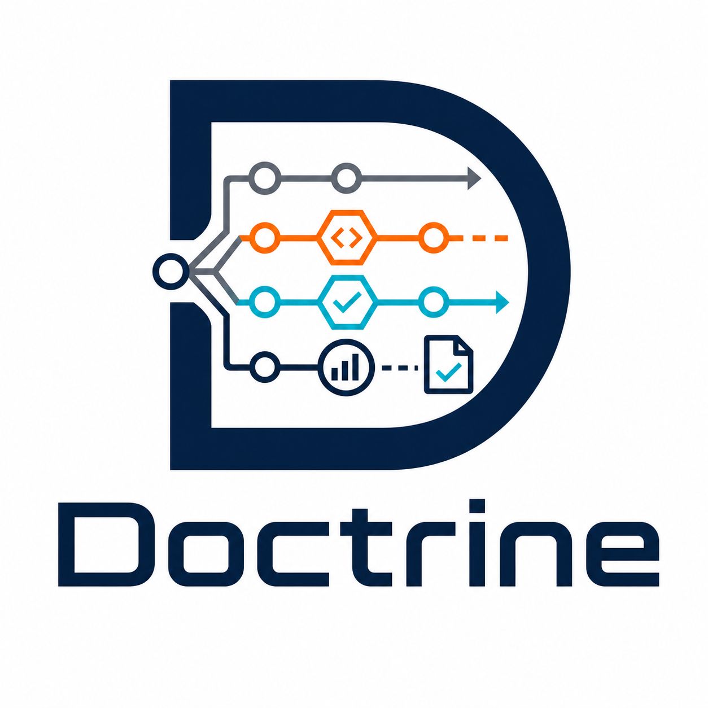

<h1 align="center">
  
</h1>

<p align="center">
  <a href="https://github.com/aroora-ai-labs/doctrine/actions/workflows/doctrine.yml"></a>
  <a href="https://github.com/aroora-ai-labs/doctrine/tags"></a>
  <a href="LICENSE"></a>
  
  <a href="#quick-start"></a>
  <a href=".Doctrine/05-packaging.md"></a>
</p>

**A gated engineering operating system for AI coding agents.** Doctrine
turns a repository into a disciplined software company: explicit
requirements, adversarial review gates, tested code, honest reports —
enforced by tooling, not vibes.

- **38 roles** with tool-enforced separation of duties (reviewers
  physically cannot edit code)
- **58 skill playbooks + 7 standards + 10 language profiles** — full-SDLC
  coverage from backend to mobile, ML, data, privacy, incident response
- **Gates G0→G7** with right-sized ceremony (a typo fix never convenes
  a council; a release always does)
- **Hash-chained session state** — the repo remembers, the model doesn't
  have to (`.doctrine-state/`, checkpoint → hydrate)
- **Gold Build deployment** (opt-in enterprise profile) — deploy only
  from content-pinned, hash-chained provenance records
- **Anti-fabrication law** — real output pasted, "fixed" requires the
  re-executed original probe, negative findings are wins

Works with **Claude Code, Codex, Cursor, Windsurf, Copilot, Gemini CLI,
Cline, Roo, Amazon Q, Continue, JetBrains Junie**, and anything that
reads [AGENTS.md](.Doctrine/adapters/AGENTS.md) or speaks MCP.

## An OS for agents

**An operating system for coding agents — not the machine that runs them.**
Doctrine owns the *policy* (how work is scheduled, isolated, remembered, and
privileged); the harness — Claude Code, Codex, Cursor, MAPLE — owns the *CPU*.
The classic OS primitives map onto real components:

- **Kernel** — `.Doctrine.md` (always loaded) fused with the fail-closed gates
  (`doctrine_lint` / `doctrine_verify` / gold-build)
- **Processes** — tasks through gates **G0→G7**, classified S/M/L/HOTFIX, run
  *as* roles with tool-enforced isolation (a reviewer physically cannot edit what
  it judges)
- **Memory** — the hash-chained **state plane** (`.doctrine-state/`): checkpoint →
  hydrate; the repo remembers so the model doesn't have to
- **Syscalls** — **§5** gates every irreversible or external action; the human is root

It's agent-count-agnostic: one agent wearing role hats, or a fleet of workers +
fresh-context verifiers. Full mapping — including where the metaphor holds and
where it's only illustrative — in
[docs/doctrine-as-an-os.md](docs/doctrine-as-an-os.md).

## Quick start

**Claude Code (plugin):**

```text
/plugin marketplace add aroora-ai-labs/doctrine
/plugin install doctrine@doctrine-marketplace
/doctrine-init
```

The plugin path needs the marketplace (public/shared). **Local or private repo?**
Use the installer below — no marketplace, no publish; it now also auto-registers the
MCP server.

**Any repo (installer):**

```bash
git clone https://github.com/aroora-ai-labs/doctrine
python doctrine/tools/doctrine_install.py --target <your-repo> \
    --tool claude,cursor,codex   # add --enterprise --ci as needed
cd <your-repo> && python tools/doctrine_state.py init && make verify
```

**Any MCP-capable agent** — the installer drops a **`.mcp.json`** registering the
`doctrineos` server (corpus lint, state plane, gold-build gates as native tools), so
Claude Code / Cursor / any `.mcp.json`-aware client offers it on approval — no
marketplace, no publish. Register by hand where a client needs it:

```bash
claude mcp add doctrineos -- python tools/doctrine_mcp.py   # Claude Code (local)
```

```toml
# Codex config.toml
[mcp_servers.doctrineos]
command = "python"
args = ["tools/doctrine_mcp.py"]
```

Full install matrix: [.Doctrine/05-packaging.md](.Doctrine/05-packaging.md).

**Drive it (once installed).** Every task engages the doctrine automatically (the
repo is the cue) — or be explicit:

- `doctrine: <task>` (any agent) or **`/doctrine <task>`** — classify, staff, gate, execute
- **`/role <name> [task]`** — act as one hat: `/role security-reviewer`, `/role chief-architect` (reviewer roles run fresh-context)
- **`/checkpoint`** — save session state so the repo remembers, not you

## How it's built (and proven)

This repo governs itself. The enforcement tooling was shipped through
Doctrine's own pipeline: brief → plan → build → **adversarial verifier
fan-out**. Four review rounds ran; every round produced real findings —
a reproduced path traversal, a state-corrupting write-order bug, a
rollback chain forkable by `git clone`, zero-byte sign-offs satisfying
"no verdict, no gold" — each vetoed, remediated with a named regression
test, and re-verified by re-running the original exploit. The full
audit trail is committed under [docs/reviews/](docs/reviews/) and
[docs/qa/](docs/qa/), and every lesson became permanent law via G7
retrospectives.

Start reading at [.Doctrine.md](.Doctrine.md) — the root operating
system (everything else loads on demand via its routing table).

```text
.Doctrine.md          the law (always loaded)
.Doctrine/            roles, skills, standards, templates, adapters,
                      state-plane spec, packaging
tools/                stdlib-only enforcement: state plane, corpus lint,
                      gold builds, MCP server, installer
plugin/               Claude Code plugin (byte-parity lint-enforced)
tests/                82 tests; `make verify` = lint + ruff + tests
.doctrine-state/      this repo's own hash-chained session memory
```

## License

[MIT](LICENSE) — © 2026 Aroora AI Labs (Mahesh Vaikri).
